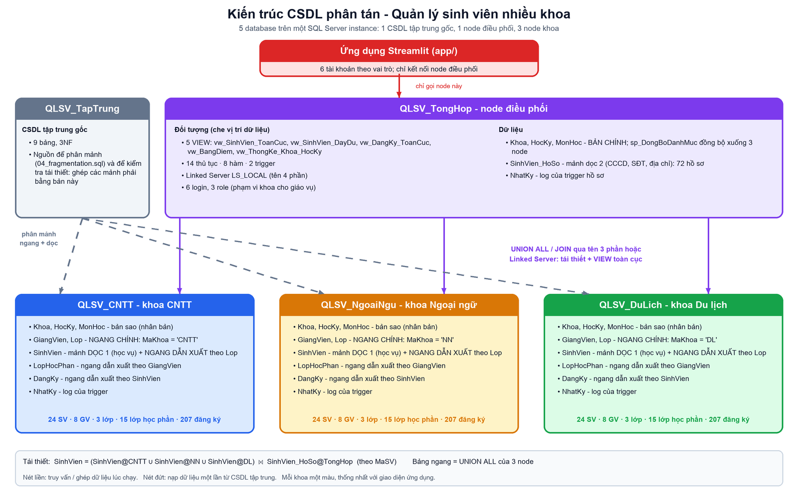

# Quản lý sinh viên nhiều khoa – CSDL phân tán (SQL Server)

Đồ án cuối kỳ học phần Cơ sở dữ liệu phân tán. Dữ liệu sinh viên, giảng viên, lớp học phần và điểm của 3 khoa
(Công nghệ thông tin, Ngoại ngữ, Du lịch) được phân tán ra nhiều node; ứng dụng và các view toàn cục cho phép
truy vấn thống nhất mà người dùng không cần biết dữ liệu nằm ở đâu.



## Kiến trúc

Mô phỏng bằng **5 database trên một SQL Server instance**:

| Database | Vai trò |
| --- | --- |
| `QLSV_TapTrung` | CSDL tập trung gốc (9 bảng, 3NF). Nguồn để phân mảnh và để kiểm tra tái thiết |
| `QLSV_TongHop` | Node điều phối: bản chính danh mục, mảnh dọc hồ sơ cá nhân, VIEW toàn cục, thủ tục, hàm, phân quyền |
| `QLSV_CNTT`, `QLSV_NgoaiNgu`, `QLSV_DuLich` | 3 node khoa: giảng viên, lớp, sinh viên, lớp học phần, đăng ký của khoa đó |

Cách phân mảnh (chi tiết trong `database/04_fragmentation.sql`):

- **Nhân bản:** `Khoa`, `HocKy`, `MonHoc` (bản chính ở TongHop, chép xuống 3 node).
- **Ngang chính theo `MaKhoa`:** `GiangVien`, `Lop`.
- **Ngang dẫn xuất:** `SinhVien` theo `Lop`; `LopHocPhan` theo `GiangVien`; `DangKy` theo `SinhVien`.
- **Dọc:** `SinhVien` thành mảnh học vụ (ở node khoa) và `SinhVien_HoSo` (CCCD, điện thoại, địa chỉ, ở TongHop).
- **Tái thiết:** bảng ngang = `UNION ALL` của 3 node; `SinhVien` = (SV của 3 node) `JOIN` `SinhVien_HoSo` theo `MaSV`.

## Cấu trúc thư mục

```
database/   12 script SQL, chạy theo thứ tự số
app/        ứng dụng Streamlit (app.py, config.py, requirements.txt, chay.sh)
report/     báo cáo Word
images/     sơ đồ và ảnh demo
docs/       HuongDan.md: hướng dẫn chi tiết (đăng nhập, quyền hạn, kiểm thử Linked Server, hiệu năng, chụp ảnh demo)
```

## Yêu cầu

- SQL Server 2019 trở lên (đã chạy thử trên **Azure SQL Edge trong Docker**, cổng 1433). Cần quyền `sysadmin` để chạy script.
- Chế độ đăng nhập **SQL Server và Windows** (đã bật sẵn với SQL Server trong Docker).
- Python 3.10+ và **ODBC Driver 18 for SQL Server** (cho ứng dụng).
- Một công cụ chạy SQL: SSMS, Azure Data Studio hoặc SQLPro for MSSQL.

Nếu cần một SQL Server nhanh bằng Docker (đổi mật khẩu `<MatKhauManh>`):

```
docker run -e ACCEPT_EULA=1 -e MSSQL_SA_PASSWORD=<MatKhauManh> -p 1433:1433 -d mcr.microsoft.com/azure-sql-edge
```

## Cài đặt cơ sở dữ liệu

Mở từng file trong `database/` bằng tài khoản quản trị, chạy cả file (F5) **theo đúng thứ tự**. Mọi file chạy lại
được nhiều lần; file lưu UTF-8 có BOM để tiếng Việt hiển thị đúng.

| # | File | Nội dung |
| --- | --- | --- |
| 1 | `01_create_databases.sql` | Tạo 5 database (xóa bản cũ nếu có) |
| 2 | `02_create_tables.sql` | Tạo bảng, khóa, ràng buộc ở từng node |
| 3 | `03_seed_data.sql` | Dữ liệu mẫu vào CSDL tập trung (3 khoa, 72 sinh viên, 621 lượt đăng ký) |
| 4 | `04_fragmentation.sql` | Phân mảnh ngang và dọc sang các node, kiểm tra tái thiết |
| 5 | `05_views.sql` | 5 view toàn cục, tái thiết và báo cáo |
| 6 | `06_queries_40.sql` | 40 truy vấn theo 8 nhóm, 30 câu phân tán (`-- [PT]`) |
| 7 | `07_procedures.sql` | 14 thủ tục (7 lõi + 7 cho ứng dụng và demo) |
| 8 | `08_functions.sql` | 8 hàm scalar và table-valued |
| 9 | `09_triggers.sql` | 7 loại trigger: kiểm soát dữ liệu và nhật ký |
| 10 | `10_security.sql` | 6 tài khoản, role, GRANT, DENY, REVOKE, phạm vi khoa cho giáo vụ |
| 11 | `11_transactions_concurrency.sql` | COMMIT, ROLLBACK; blocking, deadlock (2 cửa sổ, nằm trong comment); hiệu năng và index (phần E) |
| 12 | `12_linked_server.sql` | Linked Server `LS_LOCAL`, truy vấn tên 4 phần |

Sau khi chạy `04` và `05`, các bảng kiểm tra ở cuối file phải cho `Thieu = Thua = 0`.
Chạy lại `02` thì phải chạy lại từ `03` đến `10` (và phần E2 của `11` để tạo lại index); chạy lại `05`, `07`, `08`, `09` riêng lẻ không làm mất quyền đã cấp.

## Tài khoản

Mật khẩu ở phần 1 của `database/10_security.sql` (chỉ dùng trên máy cá nhân, đổi trước khi dùng thật).

| Tài khoản | Vai trò | Quyền chính |
| --- | --- | --- |
| `lg_admin` | Quản trị | `db_owner` ở 5 database |
| `lg_daotao` | Phòng Đào tạo | Xem mọi view, chạy mọi thủ tục, đọc hồ sơ cá nhân qua `vw_SinhVien_DayDu` |
| `lg_giaovu_cntt`, `lg_giaovu_nn`, `lg_giaovu_dl` | Giáo vụ từng khoa | Chỉ thấy và sửa điểm của khoa mình |
| `lg_bgh` | Ban giám hiệu | Chỉ xem thống kê |

Chi tiết quyền, cách đổi mật khẩu và đăng nhập thử: `docs/HuongDan.md` (mục 1 và 2).

## Chạy ứng dụng

1. Mở `app/config.py`, đặt `SERVER` theo máy chủ của bạn (ví dụ `localhost`, `localhost\SQLEXPRESS`, `localhost,1433`);
   hoặc đặt biến môi trường `QLSV_SERVER`. Nếu dùng ODBC Driver 17, đặt `QLSV_DRIVER`.
2. Trong thư mục `app/`:

   ```
   bash chay.sh
   ```

   Lần đầu script tự tạo môi trường ảo `.venv` và cài gói. Cách thủ công:
   `python3 -m venv .venv && source .venv/bin/activate && pip install -r requirements.txt && streamlit run app.py`.
3. Mở `http://localhost:8501`, chọn tài khoản và nhập mật khẩu.

Chức năng theo vai trò:

| Vai trò | Trang |
| --- | --- |
| Ban giám hiệu | Thống kê |
| Giáo vụ | Thống kê, Tìm kiếm, Bảng điểm, Nhập điểm (chỉ khoa mình) |
| Đào tạo, Quản trị | Các trang trên và thêm: Sinh viên (thêm, sửa, xóa, chuyển khoa), Đăng ký học phần, Lớp học phần, Phân tán (sơ đồ node, demo COMMIT/ROLLBACK), Nhật ký |

Tải lại trang (F5) vẫn giữ đăng nhập: mã phiên nằm trên địa chỉ trang, không giới hạn thời gian mặc định
(`PHIEN_PHUT` trong `config.py`). Không chia sẻ địa chỉ khi đang đăng nhập.

## Demo gợi ý (7 nội dung bắt buộc)

1. **Truy vấn nhiều node:** `06_queries_40.sql` (các câu `-- [PT]`) hoặc trang Phân tán.
2. **Phân mảnh ngang, dọc, tái thiết:** `04_fragmentation.sql` (bảng kiểm tra), trang Phân tán.
3. **VIEW toàn cục tương đương dữ liệu gốc:** kiểm tra cuối `05_views.sql`.
4. **COMMIT và ROLLBACK:** phần A của `11_transactions_concurrency.sql`; hoặc hai nút trong trang Phân tán.
5. **Blocking, deadlock:** phần B và C của `11` (2 cửa sổ), giám sát bằng truy vấn D1, D2.
6. **Execution Plan và index:** phần E của `11` (Clustered Index Scan → Index Seek). Hướng dẫn: `docs/HuongDan.md` (mục 4).
7. **Linked Server, tên 4 phần:** `12_linked_server.sql`. Hướng dẫn: `docs/HuongDan.md` (mục 3).

## Xử lý sự cố

| Dấu hiệu | Cách xử lý |
| --- | --- |
| `Login failed for user ...` (18456) | Sai mật khẩu, hoặc SQL Server chưa bật đăng nhập SQL; xem `docs/HuongDan.md` (mục 1.2) |
| `OpenSSL library could not be loaded` (macOS) | Homebrew đã liên kết OpenSSL 4; chạy `brew unlink openssl@4 && brew link --force openssl@3` |
| `pyarrow requires NumPy 2.0` | Dùng `bash chay.sh` (môi trường ảo riêng) thay vì môi trường conda cũ |
| `module 'config' has no attribute ...` | Sửa `config.py` xong phải khởi động lại ứng dụng (Ctrl+C, chạy lại) |
| Câu truy vấn vào `DangKy` treo mãi | Còn một giao dịch chưa kết thúc ở cửa sổ khác (phần B của `11`): chạy `ROLLBACK TRAN;` ở đó |
| `12_linked_server.sql` báo không tạo được | Đã chạy `10`? SQL Server đã bật đăng nhập hỗn hợp? Xem các dòng `Provider ... không dùng được` |

## Thành viên và phân công

| Thành viên | Phụ trách |
| --- | --- |
| TV1 (nhóm trưởng) | ............... |
| TV2 | ............... |
| TV3 | ............... |
