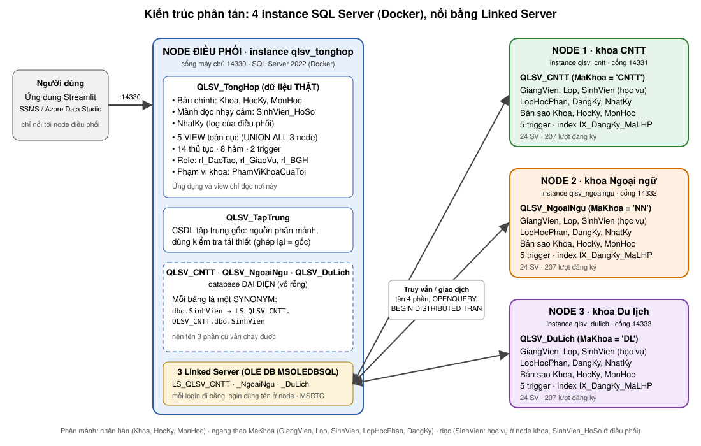

# Quản lý sinh viên nhiều khoa – CSDL phân tán (SQL Server)

Đồ án cuối kỳ học phần Cơ sở dữ liệu phân tán. Dữ liệu sinh viên, giảng viên, lớp học phần và điểm của 3 khoa
(Công nghệ thông tin, Ngoại ngữ, Du lịch) được phân tán ra nhiều node; ứng dụng và các view toàn cục cho phép
truy vấn thống nhất mà người dùng không cần biết dữ liệu nằm ở đâu.



## Kiến trúc

Hệ thống chạy trên **4 instance SQL Server riêng biệt** (4 container Docker, xem `docker-compose.yml`), nối với nhau bằng Linked Server:

| Instance (container, cổng) | Database | Vai trò |
| --- | --- | --- |
| `qlsv_tonghop` (14330) | `QLSV_TongHop` | Node điều phối: bản chính danh mục, mảnh dọc hồ sơ cá nhân, VIEW toàn cục, thủ tục, hàm, phân quyền |
| `qlsv_tonghop` (14330) | `QLSV_TapTrung` | CSDL tập trung gốc (9 bảng, 3NF). Nguồn để phân mảnh và để kiểm tra tái thiết |
| `qlsv_cntt` (14331) | `QLSV_CNTT` | Node khoa CNTT: giảng viên, lớp, sinh viên, lớp học phần, đăng ký của khoa |
| `qlsv_ngoaingu` (14332) | `QLSV_NgoaiNgu` | Node khoa Ngoại ngữ (cùng cấu trúc) |
| `qlsv_dulich` (14333) | `QLSV_DuLich` | Node khoa Du lịch (cùng cấu trúc) |

Trên instance điều phối, `QLSV_CNTT`, `QLSV_NgoaiNgu`, `QLSV_DuLich` là **database đại diện** chỉ chứa `SYNONYM` trỏ qua Linked Server
(`LS_QLSV_CNTT`, `LS_QLSV_NgoaiNgu`, `LS_QLSV_DuLich`) tới bảng thật ở instance node. Nhờ vậy tên 3 phần như `QLSV_CNTT.dbo.SinhVien` trong view,
thủ tục và ứng dụng vẫn chạy nguyên, nhưng thực chất là truy vấn liên instance; ghi vào nhiều node trong một giao dịch dùng MSDTC.
Chi tiết trong `database/02_create_nodes.sql`.

Cách phân mảnh (chi tiết trong `database/04_fragmentation.sql`):

- **Nhân bản:** `Khoa`, `HocKy`, `MonHoc` (bản chính ở TongHop, chép xuống 3 node).
- **Ngang chính theo `MaKhoa`:** `GiangVien`, `Lop`.
- **Ngang dẫn xuất:** `SinhVien` theo `Lop`; `LopHocPhan` theo `GiangVien`; `DangKy` theo `SinhVien`.
- **Dọc:** `SinhVien` thành mảnh học vụ (ở node khoa) và `SinhVien_HoSo` (CCCD, điện thoại, địa chỉ, ở TongHop).
- **Tái thiết:** bảng ngang = `UNION ALL` của 3 node; `SinhVien` = (SV của 3 node) `JOIN` `SinhVien_HoSo` theo `MaSV`.

### Bảng phân mảnh, vị trí lưu trữ và nhân bản

| Bảng | Cách phân mảnh | Lưu ở đâu | Nhân bản và đồng bộ |
| --- | --- | --- | --- |
| `Khoa`, `HocKy`, `MonHoc` | Nhân bản toàn bộ (bảng nhỏ, ít đổi, đọc nhiều) | Bản chính ở điều phối; bản sao ở cả 3 node khoa | Một chiều điều phối → node. Mỗi thay đổi ở bản chính được trigger xếp vào hàng đợi `HangDoiDongBo`; `dm_XuLyHangDoi` (gọi `sp_DongBoDanhMuc` cho từng node: sửa dòng khác, thêm dòng thiếu, không xóa) đẩy xuống. Sửa qua thủ tục `dm_Luu...` hoặc trang Danh mục là tự đồng bộ ngay; node vắng nhận sau (`14_dong_bo_danh_muc.sql`). Trigger `trg_LopHocPhan_KiemTraMonHoc` chặn giảng viên mở lớp cho môn của khoa khác (dùng bản sao ở chính node) |
| `GiangVien`, `Lop` | Ngang chính theo `MaKhoa` | Node của khoa đó | Không nhân bản: mỗi dòng có đúng một bản |
| `SinhVien` (học vụ: `MaSV, HoTen, NgaySinh, GioiTinh, MaLop, TrangThai`) | Dọc, và ngang dẫn xuất theo `Lop` | Node của khoa chứa lớp | Không nhân bản; giữ nhất quán với mảnh hồ sơ bằng giao dịch phân tán |
| `SinhVien_HoSo` (`MaSV, CCCD, DienThoai, Email, DiaChi`) | Dọc (mảnh nhạy cảm), chung khóa `MaSV` | Điều phối | Không nhân bản; luôn ghi cùng giao dịch với mảnh học vụ |
| `LopHocPhan` | Ngang dẫn xuất theo `GiangVien` | Node khoa của giảng viên mở lớp | Không nhân bản |
| `DangKy` | Ngang dẫn xuất theo `SinhVien` | Node khoa của sinh viên | Không nhân bản |
| `NhatKy` | Mỗi instance giữ nhật ký riêng của mình | Điều phối và 3 node | Không đồng bộ (nhật ký cục bộ) |
| (toàn bộ 9 bảng gốc) | `QLSV_TapTrung`: bản tập trung ban đầu | Điều phối | Chỉ dùng để phân mảnh và kiểm tra tái thiết, không dùng khi vận hành |

Kiểm tra đầy đủ, không trùng, tái thiết: phần 2 của `04_fragmentation.sql` (`Thieu = Thua = LechSoDong = 0`).
Kiểm thử đồng bộ: phần 5 của `14_dong_bo_danh_muc.sql`. Mất kết nối: `scripts/thu_mat_ket_noi.py`.

## Cấu trúc thư mục

```
database/   14 script SQL, chạy theo thứ tự số (01 đến 14; 13 là file demo vai trò)
scripts/    chay_sql.py (chạy file .sql), trien_khai.py (dựng lại cả 4 instance bằng một lệnh),
            thu_mat_ket_noi.py (dừng một node, thử, bật lại, đồng bộ lại),
            kiem_tra_demo.py (chạy 5 file demo, in ĐÚNG / SAI cho từng kết quả cần trình bày)
docker-compose.yml   4 instance SQL Server
app/        ứng dụng Streamlit (app.py, config.py, requirements.txt, chay.sh)
report/     báo cáo Word
images/     sơ đồ và ảnh demo
README_KienThuc.md   kiến thức cần nắm về hệ thống và các lưu ý (đọc trước khi bảo vệ)
docs/       HuongDan.md: hướng dẫn chi tiết (đăng nhập, quyền hạn, kiểm thử Linked Server, hiệu năng, chụp ảnh demo)
```

## Yêu cầu

- **Docker** với khoảng **8 GB RAM** (4 instance, mỗi instance giới hạn 1 GB). Trên Mac Apple Silicon image `mssql/server` chạy qua giả lập amd64 nên khởi động chậm hơn.
  **Không dùng Azure SQL Edge:** bản này không có Linked Server.
- Python 3.10+ và **ODBC Driver 18 for SQL Server** (cho ứng dụng và `scripts/`; cần `pip install pyodbc`).
- Hoặc một công cụ chạy SQL (SSMS, Azure Data Studio): nối tới `localhost,14330` (điều phối) bằng `sa`, mật khẩu trong `.env`.

Khởi động 4 instance:

```
cp .env.example .env        # rồi mở .env, đặt MSSQL_SA_PASSWORD (mật khẩu sa dùng chung cho 4 instance)
docker compose up -d
docker compose ps           # đợi cả 4 container ở trạng thái (healthy), khoảng 1 phút
```

- Mật khẩu `sa` nằm trong `.env` (đã nằm trong `.gitignore`), không nằm trong repo; `scripts/` tự đọc file này. Mật khẩu chỉ có hiệu lực lúc volume được tạo lần đầu:
  muốn đổi sau này phải xóa dữ liệu bằng `docker compose down -v`.
- Dữ liệu nằm trong volume riêng của từng node nên `docker compose down` và `up` không làm mất dữ liệu; `down -v` mới xóa.
- Cổng 14330-14333 chỉ mở cho `127.0.0.1` (máy này); các container nối với nhau qua mạng riêng của Docker.

## Cài đặt cơ sở dữ liệu

**Cách nhanh:** `python3 -I scripts/trien_khai.py` dựng lại toàn bộ (mất khoảng 1 phút) và dừng ngay khi có lỗi.

**Cách thủ công:** mở từng file trong SQLPro, SSMS hoặc Azure Data Studio, kết nối `localhost,14330` (instance điều phối) bằng `sa`, chạy cả file **theo đúng thứ tự** số. Mọi file đều chạy trên instance điều phối, không có biến phải điền: `02` tự dựng database và bảng ở 3 node từ xa qua Linked Server.
Mọi file chạy lại được nhiều lần; file lưu UTF-8 có BOM để tiếng Việt hiển thị đúng.

| # | File | Nội dung |
| --- | --- | --- |
| 1 | `01_create_tables.sql` | Tạo 5 database ở instance điều phối (xóa bản cũ nếu có) và bảng, khóa, ràng buộc của CSDL tập trung và node điều phối |
| 2 | `02_create_nodes.sql` | 3 Linked Server tới 3 node; dựng database và bảng ở cả 3 node từ xa (một khuôn DDL, mã khoa thay vào); database đại diện với synonym |
| 3 | `03_seed_data.sql` | Dữ liệu mẫu vào CSDL tập trung (3 khoa, 72 sinh viên, 621 lượt đăng ký) |
| 4 | `04_fragmentation.sql` | Phân mảnh ngang và dọc sang các node, kiểm tra tái thiết |
| 5 | `05_views.sql` | 5 view toàn cục, tái thiết và báo cáo |
| 6 | `06_queries_40.sql` | 40 truy vấn theo 8 nhóm, 30 câu phân tán (`-- [PT]`) |
| 7 | `07_procedures.sql` | 14 thủ tục (7 lõi + 7 cho ứng dụng và demo) |
| 8 | `08_functions.sql` | 8 hàm scalar và table-valued |
| 9 | `09_triggers.sql` | 7 loại trigger: kiểm soát dữ liệu và nhật ký |
| 10 | `10_security.sql` | 6 tài khoản, role, GRANT, DENY, REVOKE, phạm vi khoa cho giáo vụ |
| 11 | `11_transactions_concurrency.sql` | COMMIT, ROLLBACK; blocking, deadlock (2 cửa sổ, nằm trong comment); hiệu năng và index (phần E) |
| 12 | `12_linked_server.sql` | Truy vấn liên nút và tổng hợp toàn hệ thống qua Linked Server (tên 4 phần, OPENQUERY, giao dịch phân tán) |
| 13 | `13_demo_vai_tro.sql` | Demo khác nhau giữa các vai trò: chạy 4 lần, mỗi lần bằng một tài khoản (không chạy bằng `sa`, không nằm trong `trien_khai.py`) |
| 14 | `14_dong_bo_danh_muc.sql` | Đồng bộ và kiểm thử đồng bộ: 7 kịch bản đổi ở một nơi, kiểm tra ở cả 4 nơi (thêm, sửa, chuyển khoa, xóa sinh viên, danh mục); tự đồng bộ danh mục: hàng đợi `HangDoiDongBo`, trigger xếp hàng, `dm_XuLyHangDoi`; thủ tục quản lý danh mục `dm_LuuMonHoc`, `dm_LuuHocKy`, `dm_LuuGiangVien`, `dm_LuuLop` |

Sau khi chạy `04` và `05`, các bảng kiểm tra ở cuối file phải cho `Thieu = Thua = 0`.
Chạy lại `01` hoặc `02` thì phải chạy lại từ `02` đến `10` (và phần E2 của `11` để tạo lại index); chạy lại `05`, `07`, `08`, `09` riêng lẻ không làm mất quyền đã cấp.

## Tài khoản

Mật khẩu ở phần 1 của `database/10_security.sql`. **Đây là mật khẩu demo nằm trong mã nguồn:** chỉ dùng trên máy cá nhân; giữ nguyên việc chỉ mở cổng cho `127.0.0.1`, để repo ở chế độ private và đổi mật khẩu trước khi dùng thật (cách đổi: `docs/HuongDan.md`, mục 2.2).

| Tài khoản | Vai trò | Quyền chính |
| --- | --- | --- |
| `lg_admin` | Quản trị | `db_owner` ở các database của cả 4 instance |
| `lg_daotao` | Phòng Đào tạo | Xem mọi view, chạy mọi thủ tục, đọc hồ sơ cá nhân qua `vw_SinhVien_DayDu` |
| `lg_giaovu_cntt`, `lg_giaovu_nn`, `lg_giaovu_dl` | Giáo vụ từng khoa | Chỉ thấy và sửa điểm của khoa mình |
| `lg_bgh` | Ban giám hiệu | Chỉ xem thống kê |

Chi tiết quyền, cách đổi mật khẩu và đăng nhập thử: `docs/HuongDan.md` (mục 1 và 2).

## Chạy ứng dụng

1. `app/config.py` mặc định nối tới instance điều phối `localhost,14330`; đổi bằng biến môi trường `QLSV_SERVER` nếu cần. Nếu dùng ODBC Driver 17, đặt `QLSV_DRIVER`.
2. Trong thư mục `app/`:

   ```
   bash chay.sh
   ```

   Lần đầu script tự tạo môi trường ảo `.venv` và cài gói. Cách thủ công:
   `python3 -m venv .venv && source .venv/bin/activate && pip install -r requirements.txt && streamlit run app.py`.
3. Mở `http://localhost:8501`, chọn tài khoản và nhập mật khẩu.

Chức năng theo vai trò:

| Vai trò | Trang |
| --- | --- |
| Ban giám hiệu | Thống kê |
| Giáo vụ | Thống kê, Tìm kiếm, Bảng điểm (kèm lịch sử sửa điểm, tải CSV), Cảnh báo học vụ, Nhập điểm (chỉ khoa mình) |
| Đào tạo, Quản trị | Các trang trên và thêm: Sinh viên (thêm, sửa, xóa, chuyển khoa), Đăng ký học phần, Lớp học phần, Danh mục (thêm, sửa môn học, học kỳ, giảng viên, lớp), Phân tán (dữ liệu ở node nào, ghép hai mảnh, bảng từng node, demo COMMIT/ROLLBACK, trạng thái kết nối 4 instance, đồng bộ danh mục), Nhật ký |
| Quản trị | Thêm trang **Kiểm thử**: chạy 13 ca kiểm thử hàm, thủ tục, trigger (kể cả trigger chặn lỗi), mỗi ca báo ĐÚNG/SAI; mọi thay đổi đều được hoàn tác |
| Quản trị | Thêm trang **Phân quyền**: đóng vai từng tài khoản (`EXECUTE AS LOGIN`, quyền `IMPERSONATE` cấp ở `10_security.sql`) và thử cùng 8 việc của `13_demo_vai_tro.sql`, hiện thành bảng vai trò × việc được làm |

Tải lại trang (F5) vẫn giữ đăng nhập: mã phiên nằm trên địa chỉ trang, không giới hạn thời gian mặc định
(`PHIEN_PHUT` trong `config.py`). Không chia sẻ địa chỉ khi đang đăng nhập.

## Khi một node mất kết nối

`python3 -I scripts/thu_mat_ket_noi.py [qlsv_dulich]` dừng container của node, thử từ điều phối, bật lại và đồng bộ lại. Kết quả đã đo (node Du lịch bị dừng):

| Thao tác từ điều phối khi node vắng | Kết quả |
| --- | --- |
| Đọc dữ liệu chỉ ở điều phối (`SinhVien_HoSo`) hoặc ở node còn sống | Vẫn chạy bình thường |
| Đọc node vắng, hoặc VIEW toàn cục (cần đủ 3 node) | Lỗi sau khoảng 10 giây (không kết nối được); không trả kết quả thiếu |
| `sp_ThemSinhVien` cho lớp của khoa còn sống | **Vẫn chạy**: thủ tục hỏi lần lượt từng node và dừng ở node có lớp; giao dịch chỉ gồm node đó và điều phối |
| `sp_ThemSinhVien` cho lớp của node vắng | Lỗi 50012 sau khoảng 10 giây, không dòng nào được ghi |
| Giao dịch phân tán chạm node vắng | Lỗi, giao dịch bị hủy; điều phối không giữ dòng sửa dở |
| `sp_DongBoDanhMuc` cho node vắng | Lỗi, hủy toàn bộ (một giao dịch); không node nào bị đồng bộ nửa chừng |
| Sửa danh mục qua `dm_LuuMonHoc`, `dm_LuuHocKy` hoặc trang Danh mục | Bản chính và các node còn sống đổi ngay; mục của node vắng **ở lại hàng đợi** kèm số lần thử và lỗi |
| Sửa thẳng danh mục ở điều phối bằng `UPDATE` | Được; trigger xếp 3 mục vào hàng đợi, bản sao ở node chưa đổi cho tới lần xử lý hàng đợi |

Phục hồi: `docker start <node>` → chạy `EXEC dbo.dm_XuLyHangDoi` (hoặc bấm **Xử lý hàng đợi** ở trang Phân tán, mục Đồng bộ danh mục): node vừa trở lại nhận đủ thay đổi còn chờ, hàng đợi rỗng → chạy lại phần 2 của `04` hoặc phần 7 của `14` để kiểm tra.
Dữ liệu phân mảnh (sinh viên, đăng ký, điểm) không cần đồng bộ lại vì mỗi dòng chỉ có một bản và giao dịch bị hủy không để lại gì.
Hàng đợi chỉ dành cho danh mục nhân bản. Thao tác ghi dữ liệu phân mảnh (sinh viên, đăng ký, điểm) vào node vắng vẫn phải làm lại sau khi node trở lại.

## Giới hạn đã biết của kiến trúc nhiều instance

- **Chuỗi sở hữu giữa database không đi qua instance.** Mỗi login đi sang node bằng login cùng tên, nên mọi giáo vụ và Ban giám hiệu cần `SELECT` ở cả 3 node để các view toàn cục chạy được.
  Hệ quả: người đã có tài khoản có thể gõ thẳng tên 4 phần (`LS_QLSV_NgoaiNgu.QLSV_NgoaiNgu.dbo.DangKy`) và đọc dữ liệu học vụ của khoa khác, bỏ qua lọc `PhamViKhoaCuaToi`.
  Ghi vẫn bị node chặn (giáo vụ chỉ sửa được `DiemQT`, `DiemThi` của khoa mình) và hồ sơ nhạy cảm `SinhVien_HoSo` chỉ có ở điều phối. Muốn chặn hẳn việc đọc, phải chuyển các view thành thủ tục `EXECUTE AS` (chưa làm).
- **Deadlock phân tán không được phát hiện** (mỗi instance chỉ thấy khóa của mình): dùng `SET LOCK_TIMEOUT`.
- **Bảng ở node xa không dùng được `OUTPUT ... INTO`** (đã sửa câu 34, 35 của `06`).

## Demo gợi ý (7 nội dung bắt buộc)

1. **Truy vấn nhiều node:** `06_queries_40.sql` (các câu `-- [PT]`) hoặc trang Phân tán.
2. **Phân mảnh ngang, dọc, tái thiết:** `04_fragmentation.sql` (bảng kiểm tra), trang Phân tán.
3. **VIEW toàn cục tương đương dữ liệu gốc:** kiểm tra cuối `05_views.sql`.
4. **COMMIT và ROLLBACK:** phần A của `11_transactions_concurrency.sql`; hoặc hai nút trong trang Phân tán.
5. **Blocking, deadlock:** phần B và C của `11` (2 cửa sổ), giám sát bằng truy vấn D1, D2.
6. **Execution Plan và index:** phần E của `11` (Clustered Index Scan → Index Seek). Hướng dẫn: `docs/HuongDan.md` (mục 4).
7. **Linked Server, tên 4 phần, truy vấn liên nút và tổng hợp:** `12_linked_server.sql`; sơ đồ ở `images/kien_truc_phan_tan.svg`. Hướng dẫn: `docs/HuongDan.md` (mục 3).

## Xử lý sự cố

| Dấu hiệu | Cách xử lý |
| --- | --- |
| `Login failed for user ...` (18456) | Sai mật khẩu, hoặc SQL Server chưa bật đăng nhập SQL; xem `docs/HuongDan.md` (mục 1.2) |
| `OpenSSL library could not be loaded` (macOS) | Homebrew đã liên kết OpenSSL 4; chạy `brew unlink openssl@4 && brew link --force openssl@3` |
| `pyarrow requires NumPy 2.0` | Dùng `bash chay.sh` (môi trường ảo riêng) thay vì môi trường conda cũ |
| `module 'config' has no attribute ...` | Sửa `config.py` xong phải khởi động lại ứng dụng (Ctrl+C, chạy lại) |
| Câu truy vấn vào `DangKy` treo mãi | Còn một giao dịch chưa kết thúc ở cửa sổ khác (phần B của `11`): chạy `ROLLBACK TRAN;` ở đó |
| `02` báo không nối được node | Container node chưa sẵn sàng (đợi thêm) hoặc chưa `docker compose up -d`; kiểm tra `docker compose ps` |
| Lỗi 7416 `no login-mapping exists` | Linked Server tạo với `@provstr`: bỏ chuỗi đó (xem `02`) rồi chạy lại từ `02` đến `10` |
| Lỗi 7395 `nested transaction ... XACT_ABORT` | Ghi vào node trong `BEGIN TRAN` cần `SET XACT_ABORT ON;` ở đầu phiên |
| Lỗi 1206 `MS DTC has cancelled` | Một trigger ở node tự ROLLBACK bên trong giao dịch phân tán; chạy lệnh đó trực tiếp trên node (xem demo Trigger 3 ở `09`) |

## Thành viên và phân công

| Thành viên | Phụ trách |
| --- | --- |
| TV1 (nhóm trưởng) | ............... |
| TV2 | ............... |
| TV3 | ............... |
