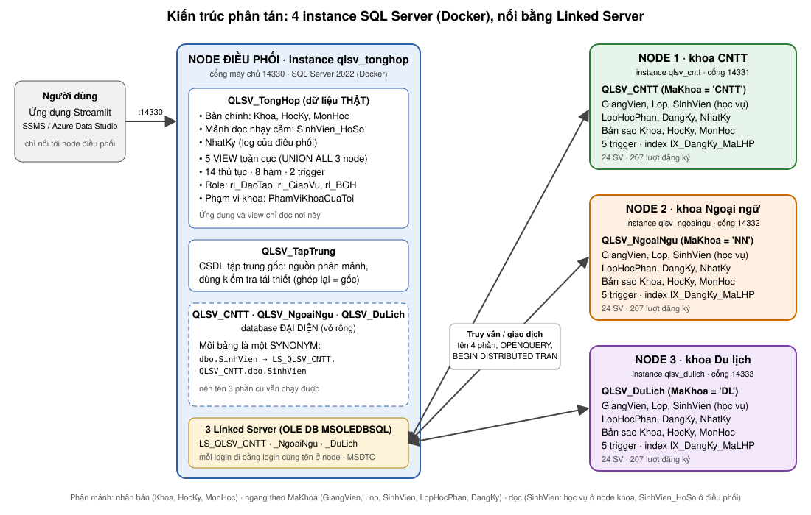

# Kiến thức cần nắm về hệ thống Quản lý sinh viên nhiều khoa (CSDL phân tán)

Tài liệu này giải thích **hệ thống hoạt động thế nào và vì sao lại làm như vậy**, để đọc hiểu mã nguồn và trả lời câu hỏi khi bảo vệ.
Cách cài đặt và chạy nằm ở [`README.md`](README.md); các bước demo nằm ở [`docs/HuongDan.md`](docs/HuongDan.md) và [`docs/KichBanTrinhBay.md`](docs/KichBanTrinhBay.md).

Mục lục:
[1. Bài toán](#1-bài-toán) ·
[2. Kiến trúc](#2-kiến-trúc-4-instance) ·
[3. Mô hình dữ liệu](#3-mô-hình-dữ-liệu) ·
[4. Phân mảnh](#4-phân-mảnh) ·
[5. Linked Server và synonym](#5-linked-server-và-synonym) ·
[6. View toàn cục](#6-view-toàn-cục-và-tính-trong-suốt) ·
[7. Giao dịch phân tán](#7-giao-dịch-phân-tán) ·
[8. Thủ tục, hàm, trigger](#8-thủ-tục-hàm-trigger) ·
[9. Nhân bản và đồng bộ](#9-nhân-bản-và-đồng-bộ-danh-mục) ·
[10. Phân quyền](#10-phân-quyền) ·
[11. Tương tranh và hiệu năng](#11-tương-tranh-và-hiệu-năng) ·
[12. Khi một node hỏng](#12-khi-một-node-hỏng) ·
[13. Ứng dụng](#13-ứng-dụng-streamlit) ·
[14. Các file SQL](#14-các-file-sql-theo-thứ-tự) ·
[15. Lưu ý quan trọng](#15-lưu-ý-quan-trọng) ·
[16. Giới hạn đã biết](#16-giới-hạn-đã-biết) ·
[17. Câu hỏi thường gặp](#17-câu-hỏi-thường-gặp-khi-bảo-vệ) ·
[18. Thuật ngữ](#18-thuật-ngữ)

---

## 1. Bài toán

Một trường có 3 khoa: Công nghệ thông tin (`CNTT`), Ngoại ngữ (`NN`), Du lịch (`DL`). Mỗi khoa tự quản lý giảng viên, lớp, sinh viên,
lớp học phần và điểm của mình; phòng Đào tạo và Ban giám hiệu cần nhìn toàn trường.

Giải pháp tập trung (một database cho tất cả) đơn giản nhưng mọi khoa phụ thuộc vào một máy. Giải pháp phân tán đặt dữ liệu của khoa
nào ở máy của khoa đó, và thêm một máy điều phối để nhìn chung. Đồ án làm cả hai: `QLSV_TapTrung` là bản tập trung gốc, từ đó
**phân mảnh** ra 4 nơi, rồi chứng minh ghép lại thì được đúng bản gốc.

Số liệu mẫu: 3 khoa, 72 sinh viên, 621 lượt đăng ký học phần.

## 2. Kiến trúc: 4 instance



| Instance (container) | Cổng trên máy | Database | Vai trò |
| --- | --- | --- | --- |
| `qlsv_tonghop` | 14330 | `QLSV_TongHop` | **Điều phối**: bản chính danh mục, hồ sơ cá nhân, view toàn cục, thủ tục, hàm, phân quyền |
| `qlsv_tonghop` | 14330 | `QLSV_TapTrung` | Bản tập trung gốc: chỉ để phân mảnh và đối chiếu, không dùng khi vận hành |
| `qlsv_cntt` | 14331 | `QLSV_CNTT` | Node khoa CNTT |
| `qlsv_ngoaingu` | 14332 | `QLSV_NgoaiNgu` | Node khoa Ngoại ngữ |
| `qlsv_dulich` | 14333 | `QLSV_DuLich` | Node khoa Du lịch |

Điều cần nắm:

- **Instance khác database.** Một instance là một tiến trình SQL Server riêng (ở đây là một container), có login, bộ nhớ và nhật ký giao dịch riêng.
  Nhiều database trong cùng một instance chưa phải là phân tán thật; 4 instance mới buộc phải dùng Linked Server và giao dịch phân tán.
- **Mọi thao tác đi qua điều phối.** Ứng dụng và các file SQL chỉ nối tới `localhost,14330`. Điều phối chuyển lệnh sang node qua Linked Server.
- **Ba node có cấu trúc giống hệt nhau**, chỉ khác tên database và mã khoa. Vì thế `02_create_nodes.sql` viết định nghĩa bảng một lần rồi gửi sang cả 3.
- **Trong mạng Docker**, các container gọi nhau bằng tên (`qlsv_cntt`, cổng 1433). Cổng 14330 đến 14333 chỉ là cửa mở ra máy của bạn, và chỉ cho `127.0.0.1`.

## 3. Mô hình dữ liệu

Chín bảng, chuẩn 3NF (sơ đồ: `images/erd_taptrung.png`):

| Bảng | Khóa chính | Ý nghĩa | Tham chiếu tới |
| --- | --- | --- | --- |
| `Khoa` | `MaKhoa` | Khoa | |
| `HocKy` | `MaHK` (ví dụ `HK1-2526`) | Học kỳ | |
| `MonHoc` | `MaMH` | Môn học; `MaKhoa = NULL` là môn chung toàn trường | `Khoa` |
| `GiangVien` | `MaGV` | Giảng viên | `Khoa` |
| `Lop` | `MaLop` (ví dụ `65.CNTT-1`) | Lớp sinh hoạt | `Khoa`, `GiangVien` (chủ nhiệm) |
| `SinhVien` | `MaSV` (8 chữ số) | Sinh viên | `Lop` |
| `LopHocPhan` | `MaLHP` | Một môn mở trong một học kỳ, do một giảng viên dạy | `MonHoc`, `HocKy`, `GiangVien` |
| `DangKy` | (`MaSV`, `MaLHP`) | Sinh viên đăng ký lớp học phần, kèm điểm | `SinhVien`, `LopHocPhan` |
| `NhatKy` | `MaNK` | Nhật ký thay đổi, do trigger ghi | |

Quy ước điểm:

- `DiemTK = ROUND(DiemQT × 0,4 + DiemThi × 0,6, 1)`. Đây là **cột tính toán** (`PERSISTED`): không nhập, không chép được, SQL Server tự tính.
- Thiếu `DiemQT` hoặc `DiemThi` thì `DiemTK = NULL`, nghĩa là "chưa có điểm"; không tính vào trung bình hay tỷ lệ đạt.
- **Từ 5,0 trở lên là Đạt, dưới 5,0 là Không đạt.**
- Xếp loại: Giỏi từ 8; Khá từ 6,5; Trung bình từ 5; Không đạt dưới 5.
- Điểm trung bình tích lũy của sinh viên có **trọng số là số tín chỉ**; tín chỉ tích lũy chỉ cộng các môn đạt.

## 4. Phân mảnh

Phân mảnh là chia một bảng thành nhiều phần đặt ở nhiều nơi. Có ba kiểu, đồ án dùng cả ba.

### 4.1. Phân mảnh ngang chính

Chia **theo dòng**, dựa trên một điều kiện của chính bảng đó.

- `GiangVien` và `Lop` chia theo `MaKhoa`: dòng có `MaKhoa = 'CNTT'` nằm ở node CNTT, và tương tự.
- Mỗi node có ràng buộc `CHECK (MaKhoa = 'CNTT')` (hoặc `'NN'`, `'DL'`). Đây chính là **vị từ phân mảnh** được cài thành ràng buộc: node không thể chứa nhầm dòng của khoa khác.

### 4.2. Phân mảnh ngang dẫn xuất

Bảng **không có cột `MaKhoa`** nên chia theo bảng mà nó tham chiếu tới.

| Bảng | Đi theo | Lý do |
| --- | --- | --- |
| `SinhVien` | `Lop` | Sinh viên thuộc lớp nào thì nằm cùng node với lớp đó |
| `LopHocPhan` | `GiangVien` | Lớp học phần nằm ở node khoa của giảng viên mở lớp |
| `DangKy` | `SinhVien` | Đăng ký và điểm nằm cùng node với sinh viên |

Khóa ngoại cục bộ ở node (`SinhVien → Lop`, `DangKy → SinhVien`) bảo đảm điều này: sinh viên không thể trỏ tới lớp không có ở node.
Lợi ích: các phép nối thường dùng (sinh viên với lớp, đăng ký với sinh viên) đều chạy **trong một node**, không qua mạng.

### 4.3. Phân mảnh dọc

Chia **theo cột**. `SinhVien` tách thành hai mảnh:

| Mảnh | Cột | Nơi lưu |
| --- | --- | --- |
| Học vụ | `MaSV, HoTen, NgaySinh, GioiTinh, MaLop, TrangThai` | Node khoa |
| Hồ sơ (`SinhVien_HoSo`) | `MaSV, CCCD, DienThoai, Email, DiaChi` | Điều phối |

- Hai mảnh **đều giữ khóa chính `MaSV`**; đây là điều kiện bắt buộc để nối lại.
- Lý do tách: thông tin nhạy cảm (CCCD, địa chỉ) nằm riêng một chỗ, giáo vụ khoa không đọc được.
- Khóa ngoại không bắc qua instance được, nên trigger `trg_HoSo_KiemTraSinhVien` làm thay: hồ sơ phải ứng với một sinh viên có thật ở một node (lỗi 50905).

### 4.4. Nhân bản

`Khoa`, `HocKy`, `MonHoc` là danh mục nhỏ, ít đổi, bảng nào ở node cũng tham chiếu tới. Chúng có **bản chính ở điều phối và bản sao ở cả 3 node**,
để khóa ngoại ở node kiểm tra tại chỗ. Cách giữ bản sao khớp bản chính: mục 9.

### 4.5. Ba tính chất phải chứng minh

| Tính chất | Nghĩa là | Kiểm tra trong đồ án |
| --- | --- | --- |
| **Đầy đủ** | Không dòng nào của bản gốc bị mất | `Thieu = 0` |
| **Tái thiết được** | Ghép các mảnh lại thì ra đúng bản gốc | `Thua = 0`, `LechSoDong = 0` |
| **Tách biệt** | Không dòng nào nằm ở hai mảnh | Không có `MaSV`, `MaGV`... trùng giữa các node |

Cách tái thiết:

- Bảng phân mảnh ngang = `UNION ALL` của 3 node.
- `SinhVien` đầy đủ = (`SinhVien` của 3 node) `JOIN SinhVien_HoSo ON MaSV`.

Phần 2 của `04_fragmentation.sql` so từng bảng với `QLSV_TapTrung` bằng `EXCEPT` hai chiều; lệch một dòng là file báo lỗi 50001.

## 5. Linked Server và synonym

**Linked Server** là một kết nối đặt tên sẵn từ instance này sang instance khác. Điều phối có 3 cái: `LS_QLSV_CNTT`, `LS_QLSV_NgoaiNgu`, `LS_QLSV_DuLich`.

Ba cách gọi sang node:

| Cách | Ví dụ | Khi nào dùng |
| --- | --- | --- |
| Tên 4 phần | `SELECT ... FROM LS_QLSV_CNTT.QLSV_CNTT.dbo.SinhVien` | Truy vấn và ghi thông thường |
| `OPENQUERY` | `SELECT * FROM OPENQUERY(LS_QLSV_CNTT, 'SELECT ...')` | Muốn cả câu lệnh chạy ở node, chỉ trả kết quả về |
| `EXEC ... AT` hoặc `sp_executesql` từ xa | `EXEC LS_QLSV_CNTT.QLSV_CNTT.sys.sp_executesql N'...'` | Lệnh DDL (`CREATE TABLE`, `ALTER TABLE`, tắt/bật trigger) |

**Synonym** là tên thay thế. Trên điều phối có 3 database "vỏ rỗng" `QLSV_CNTT`, `QLSV_NgoaiNgu`, `QLSV_DuLich`, bên trong chỉ có synonym:

```sql
CREATE SYNONYM dbo.SinhVien FOR LS_QLSV_CNTT.QLSV_CNTT.dbo.SinhVien;
```

Nhờ đó mã nguồn viết tên 3 phần `QLSV_CNTT.dbo.SinhVien` như thể bảng nằm tại chỗ, nhưng thực chất là truy vấn sang instance khác.

Các tùy chọn của Linked Server (đặt trong `02`):

| Tùy chọn | Tác dụng |
| --- | --- |
| `rpc out` | Cho phép gọi thủ tục và SQL động ở node |
| `remote proc transaction promotion` | Cho phép giao dịch lan sang node (MSDTC) |
| `collation compatible` | Hai bên cùng `Vietnamese_CI_AS`, nên điều kiện lọc được đẩy sang node thay vì kéo cả bảng về |
| `@useself = TRUE` | Mỗi login đi sang node bằng **chính login cùng tên**; không có tài khoản dùng chung |

## 6. View toàn cục và tính trong suốt

**Trong suốt phân tán** nghĩa là người dùng truy vấn mà không cần biết dữ liệu nằm ở node nào.

| View | Nội dung |
| --- | --- |
| `vw_SinhVien_ToanCuc` | `UNION ALL` sinh viên và lớp của 3 node |
| `vw_SinhVien_DayDu` | View trên nối với `SinhVien_HoSo`: tái thiết mảnh dọc |
| `vw_DangKy_ToanCuc` | `UNION ALL` đăng ký và lớp học phần của 3 node |
| `vw_BangDiem` | Bảng điểm chi tiết toàn trường, có cột `KetQua` (Đạt, Không đạt, Chưa có điểm) |
| `vw_ThongKe_Khoa_HocKy` | Số sinh viên, lượt đăng ký, điểm trung bình, tỷ lệ đạt theo khoa và học kỳ |

Hàm `PhamViKhoaCuaToi()` trả về các khoa mà người đang đăng nhập được xem. View lọc theo hàm này, nên cùng một câu `SELECT`
giáo vụ CNTT chỉ thấy khoa CNTT còn Đào tạo thấy cả trường.

## 7. Giao dịch phân tán

Một thao tác nghiệp vụ thường ghi vào **hai instance**. Ví dụ thêm sinh viên: mảnh học vụ vào node khoa, mảnh hồ sơ vào điều phối.
Hai lệnh phải cùng thành công hoặc cùng hủy; nếu không sẽ có sinh viên thiếu hồ sơ.

- **MSDTC** (Distributed Transaction Coordinator) điều khiển việc này bằng **cam kết hai pha (2PC)**:
  pha 1 hỏi mọi bên "sẵn sàng ghi chưa", pha 2 chỉ khi tất cả đồng ý mới ra lệnh ghi thật; một bên từ chối thì tất cả hủy.
- Giao dịch thường tự **nâng cấp** thành giao dịch phân tán khi chạm tới Linked Server.
- **`SET XACT_ABORT ON` là bắt buộc** khi ghi qua Linked Server trong `BEGIN TRAN` (thiếu thì lỗi 7395). Nó cũng bảo đảm lỗi bất kỳ làm hủy cả giao dịch.

Khuôn mẫu dùng trong mọi thủ tục ghi:

```sql
SET XACT_ABORT ON;
BEGIN TRY
    BEGIN TRAN;
        INSERT QLSV_CNTT.dbo.SinhVien (...) VALUES (...);          -- node khoa
        INSERT QLSV_TongHop.dbo.SinhVien_HoSo (...) VALUES (...);  -- điều phối
    COMMIT;
END TRY
BEGIN CATCH
    IF @@TRANCOUNT > 0 ROLLBACK;
    THROW;
END CATCH
```

Demo: phần A của `11_transactions_concurrency.sql`, `sp_DemoGiaoDich`, hoặc hai nút COMMIT/ROLLBACK ở trang Phân tán.

## 8. Thủ tục, hàm, trigger

### 8.1. Thủ tục (`07_procedures.sql`)

| Thủ tục | Việc làm | Điểm phân tán |
| --- | --- | --- |
| `sp_ThemSinhVien` | Thêm sinh viên | Ghi 2 mảnh dọc ở 2 instance trong một giao dịch |
| `sp_CapNhatSinhVien`, `sp_XoaSinhVien` | Sửa, xóa sinh viên | Cả 2 mảnh dọc |
| `sp_ChuyenKhoa` | Chuyển sinh viên sang khoa khác | Xóa ở node cũ, thêm ở node mới, một giao dịch trên 2 node |
| `sp_DangKyHocPhan`, `sp_HuyDangKy` | Đăng ký, hủy đăng ký | Khóa `UPDLOCK, HOLDLOCK` để hai người không cùng lấy chỗ cuối |
| `sp_NhapDiem` | Nhập, sửa điểm | Ghi ở node của sinh viên |
| `sp_MoLopHocPhan` | Mở lớp học phần | Ghi ở node khoa của giảng viên |
| `sp_BangDiemSinhVien`, `sp_ThongKeKhoa`, `sp_TimSinhVien` | Báo cáo, tìm kiếm | Đọc qua view toàn cục |
| `sp_DongBoDanhMuc` | Đồng bộ danh mục xuống node | Mục 9 |
| `sp_DemoGiaoDich`, `sp_PhanBoDuLieu` | Phục vụ demo | |

Hai thành phần dùng chung:

- `DbCuaKhoa(@MaKhoa)`: đổi mã khoa thành tên database (`'CNTT'` → `QLSV_CNTT`). Thủ tục dùng nó để ghép SQL động trỏ đúng node.
- `TimKhoaCuaLop`: hỏi **lần lượt từng node** xem lớp nằm ở đâu và dừng ngay khi thấy. Nhờ vậy thêm sinh viên vào khoa còn sống vẫn chạy khi một khoa khác tắt.

Mã lỗi nghiệp vụ nằm trong dải 50010 đến 50107; ứng dụng hiển thị nguyên thông báo tiếng Việt của lỗi.

### 8.2. Hàm (`08_functions.sql`)

| Hàm | Loại | Trả về |
| --- | --- | --- |
| `fn_XepLoaiDiem` | scalar | Xếp loại của một điểm |
| `fn_DiemTBTichLuy` | scalar | Điểm trung bình tích lũy (trọng số tín chỉ) |
| `fn_TinChiTichLuy` | scalar | Tổng tín chỉ các môn đạt |
| `fn_XepLoaiHocLuc` | scalar | Xếp loại học lực của sinh viên |
| `fn_SiSoLopHocPhan` | scalar | Số sinh viên đã đăng ký một lớp học phần |
| `fn_BangDiemSinhVien`, `fn_DanhSachLop`, `fn_TopSinhVien` | table-valued | Bảng điểm, danh sách lớp, top N sinh viên |

Hàm **scalar** trả một giá trị; hàm **table-valued** trả một bảng và dùng được trong `FROM`.

### 8.3. Trigger (`09_triggers.sql`)

| Trigger | Bảng | Kiểu | Việc làm | Lỗi |
| --- | --- | --- | --- | --- |
| `trg_SinhVien_ChanXoa` | `SinhVien` (node) | `INSTEAD OF DELETE` | Chặn xóa sinh viên đã có đăng ký | 50901 |
| `trg_LopHocPhan_KiemTraMonHoc` | `LopHocPhan` (node) | `AFTER` | Môn phải của khoa giảng viên hoặc môn chung | 50902 |
| `trg_DangKy_KiemTraDangKy` | `DangKy` (node) | `AFTER INSERT` | Chỉ sinh viên đang học; không vượt sĩ số | 50903, 50904 |
| `trg_HoSo_KiemTraSinhVien` | `SinhVien_HoSo` (điều phối) | `AFTER` | Hồ sơ phải có sinh viên ở một node | 50905 |
| `trg_DangKy_GhiNhatKy`, `trg_SinhVien_GhiNhatKy`, `trg_HoSo_GhiNhatKy` | | `AFTER` | Ghi `NhatKy` (giá trị cũ, mới, người sửa, thời gian) | |

- `AFTER` chạy **sau** lệnh, có thể `ROLLBACK` để hủy. `INSTEAD OF` chạy **thay cho** lệnh.
- Trong trigger, bảng ảo `inserted` chứa dòng mới và `deleted` chứa dòng cũ.
- **Trigger ở node chỉ dùng dữ liệu tại node.** Trigger gọi ngược về điều phối trong giao dịch phân tán gây lỗi 3910, nên quy tắc "môn của khoa" dùng bản sao `MonHoc` ngay tại node.

## 9. Nhân bản và đồng bộ danh mục

Mô hình: **một bản chính, đồng bộ một chiều** từ điều phối xuống node. Node không sửa danh mục.

```
Sửa bản chính ──► trigger xếp 3 mục (mỗi node một mục) vào HangDoiDongBo
                         │
                  dm_XuLyHangDoi ──► sp_DongBoDanhMuc cho từng node
                         │
          node nhận được: xóa mục │ node tắt: mục ở lại, ghi số lần thử và lỗi
```

- **Trigger chỉ xếp hàng**, không tự đẩy sang node. Nếu trigger gọi node mà node tắt thì lệnh sửa bản chính cũng thất bại; xếp hàng thì không.
- `dm_LuuMonHoc`, `dm_LuuHocKy` (và trang Danh mục) sửa bản chính rồi gọi ngay `dm_XuLyHangDoi`, nên bình thường đồng bộ xong tức thì.
- Node tắt thì mục của nó chờ trong hàng đợi; khi node trở lại chỉ cần chạy `EXEC dbo.dm_XuLyHangDoi`.
- `sp_DongBoDanhMuc` sửa dòng khác, thêm dòng thiếu, **không xóa** (dòng ở node có thể đang được tham chiếu).
- Kiểu nhất quán: **nhất quán sau cùng** (eventual consistency). Trong lúc node tắt, bản sao của nó cũ hơn bản chính.
- Hàng đợi **chỉ cho danh mục nhân bản**. Sinh viên, đăng ký, điểm mỗi dòng có một bản duy nhất, được bảo vệ bằng giao dịch phân tán, không cần đồng bộ.

`dm_LuuGiangVien`, `dm_LuuLop` thì ghi thẳng vào node của khoa (dữ liệu phân mảnh, không nhân bản). Mã giảng viên và mã lớp là duy nhất trên cả 3 node;
chọn "Thêm mới" mà mã đã có thì lỗi 50107.

Bảy kịch bản kiểm thử đồng bộ nằm ở phần 5 của `14_dong_bo_danh_muc.sql`; `ViTriSinhVien`, `ViTriMonHoc` cho biết một dòng đang nằm ở những nơi nào.

## 10. Phân quyền

Ba tầng: **login** (đăng nhập vào instance) → **user** (trong từng database) → **role** (nhóm quyền).

| Tài khoản | Vai trò | Được làm |
| --- | --- | --- |
| `lg_admin` | Quản trị | Mọi thứ (`db_owner`), kể cả đóng vai tài khoản khác để kiểm tra quyền |
| `lg_daotao` | Phòng Đào tạo | Xem mọi view, chạy mọi thủ tục nghiệp vụ, đọc hồ sơ cá nhân |
| `lg_giaovu_cntt`, `lg_giaovu_nn`, `lg_giaovu_dl` | Giáo vụ khoa | Chỉ xem và nhập điểm khoa mình |
| `lg_bgh` | Ban giám hiệu | Chỉ xem thống kê |

- `GRANT` cấp quyền, `DENY` cấm (thắng `GRANT`), `REVOKE` gỡ một `GRANT` hoặc `DENY` đã đặt.
- **Lọc theo dòng** bằng view và `PhamViKhoaCuaToi()`: giáo vụ không có quyền trên bảng, chỉ có quyền trên view đã lọc.
- **Lọc theo cột** ở node: giáo vụ chỉ được `UPDATE` hai cột `DiemQT`, `DiemThi`.
- Sáu login có ở **cả 4 instance** với cùng mật khẩu, và Linked Server ánh xạ từng login sang login cùng tên. Quyền vì thế được kiểm tra hai lần: ở điều phối và ở node.
- `lg_admin` có `IMPERSONATE` trên 5 login còn lại; trang Phân quyền dùng `EXECUTE AS LOGIN` để thử cùng 8 việc dưới từng vai trò.

Vì sao tách `lg_admin` và `lg_daotao`: quản trị lo cấu trúc và quyền, Đào tạo lo nghiệp vụ. Đào tạo không cần và không nên có quyền xóa bảng hay cấp quyền (nguyên tắc quyền tối thiểu).

Mật khẩu demo nằm trong `10_security.sql` và `docs/HuongDan.md`.

## 11. Tương tranh và hiệu năng

| Hiện tượng | Nghĩa là | Trong đồ án |
| --- | --- | --- |
| **Blocking** | Phiên B chờ khóa phiên A đang giữ | Phần B của `11`: hai cửa sổ cùng sửa một dòng `DangKy` |
| **Deadlock** | A chờ B, B chờ A | Phần C của `11`. Cùng instance: SQL Server tự chọn một bên làm nạn nhân (lỗi 1205) |
| **Deadlock phân tán** | Vòng chờ trải trên hai instance | **Không ai phát hiện**: mỗi instance chỉ thấy khóa của mình. Dùng `SET LOCK_TIMEOUT` để tự thoát (lỗi 1222) |
| **Mất chỗ cuối** | Hai người cùng đăng ký chỗ cuối của lớp | `sp_DangKyHocPhan` đọc sĩ số với `UPDLOCK, HOLDLOCK` |

Hiệu năng (phần E của `11`): thêm index trên `DangKy` đổi kế hoạch thực thi từ **Clustered Index Scan** (quét cả bảng) sang **Index Seek** (nhảy thẳng tới dòng cần).
Với truy vấn phân tán, điều quan trọng nhất là **lọc ở node rồi mới gửi về**, không kéo cả bảng qua mạng; đó là lý do đặt `collation compatible`.

## 12. Khi một node hỏng

| Thao tác khi một node tắt | Kết quả |
| --- | --- |
| Đọc dữ liệu chỉ ở điều phối hoặc ở node còn sống | Chạy bình thường |
| Đọc view toàn cục | Lỗi sau khoảng 10 giây; **không** trả kết quả thiếu |
| Thêm sinh viên vào khoa còn sống | Vẫn chạy |
| Thêm sinh viên vào khoa đang tắt | Lỗi 50012, không ghi gì |
| Giao dịch phân tán chạm node tắt | Hủy toàn bộ, không có dữ liệu dở dang |
| Sửa danh mục | Bản chính và node còn sống đổi ngay; mục của node tắt chờ trong hàng đợi |
| Thêm, sửa giảng viên hoặc lớp ở trang Danh mục | Không lưu được: kiểm tra trùng mã cần cả 3 node |

Phục hồi: `docker start <tên container>` rồi `EXEC dbo.dm_XuLyHangDoi`. Thử tự động: `python3 -I scripts/thu_mat_ket_noi.py`.

Hệ thống chọn **nhất quán hơn sẵn sàng**: thà báo lỗi còn hơn trả một báo cáo thiếu một khoa mà người xem không biết.

## 13. Ứng dụng Streamlit

`app/app.py` nối tới điều phối bằng tài khoản người dùng nhập, nên **quyền do SQL Server quyết định**, không phải do giao diện.

| Trang | Ai thấy | Dùng gì ở CSDL |
| --- | --- | --- |
| Thống kê | Tất cả | `vw_ThongKe_Khoa_HocKy`, `sp_ThongKeKhoa`, `fn_TopSinhVien` |
| Tìm kiếm, Bảng điểm, Cảnh báo học vụ, Nhập điểm | Giáo vụ trở lên | `sp_TimSinhVien`, `sp_BangDiemSinhVien`, `sp_NhapDiem` |
| Sinh viên, Đăng ký học phần, Lớp học phần, Danh mục, Phân tán, Nhật ký | Đào tạo, Quản trị | Các thủ tục ở mục 8 và 9 |
| Kiểm thử, Phân quyền | Quản trị | Chạy từng ca kiểm thử; đóng vai từng tài khoản |

Trang **Phân tán** là nơi trình diễn: dữ liệu nằm ở node nào, ghép hai mảnh dọc, COMMIT/ROLLBACK, trạng thái 4 instance, hàng đợi đồng bộ.
Trang **Kiểm thử** hoàn tác mọi thay đổi sau khi chạy.

## 14. Các file SQL theo thứ tự

| File | Nội dung | Kiến thức minh họa |
| --- | --- | --- |
| `01_create_tables.sql` | 5 database ở điều phối, bảng của bản tập trung và điều phối | Thiết kế 3NF, ràng buộc |
| `02_create_nodes.sql` | Linked Server, database và bảng ở 3 node, synonym | Linked Server, vị từ phân mảnh |
| `03_seed_data.sql` | Dữ liệu mẫu vào bản tập trung | |
| `04_fragmentation.sql` | Chuyển dữ liệu sang các node, kiểm tra | Ba kiểu phân mảnh, ba tính chất |
| `05_views.sql` | 5 view toàn cục | Trong suốt, tái thiết |
| `06_queries_40.sql` | 40 truy vấn, 30 câu phân tán | Truy vấn liên node |
| `07_procedures.sql` | 14 thủ tục | Giao dịch phân tán |
| `08_functions.sql` | 8 hàm | Scalar, table-valued |
| `09_triggers.sql` | 7 trigger | Ràng buộc liên instance, nhật ký |
| `10_security.sql` | Login, role, quyền | Phân quyền trên nhiều instance |
| `11_transactions_concurrency.sql` | COMMIT, ROLLBACK, blocking, deadlock, index | Tương tranh, hiệu năng |
| `12_linked_server.sql` | Tên 4 phần, `OPENQUERY`, `EXEC AT` | Truy vấn liên nút |
| `13_demo_vai_tro.sql` | Chạy bằng từng tài khoản, **không chạy bằng `sa`** | So sánh quyền |
| `14_dong_bo_danh_muc.sql` | Hàng đợi, đồng bộ, 7 kịch bản | Nhân bản, nhất quán sau cùng |

Dựng lại toàn bộ: `python3 -I scripts/trien_khai.py`. Tự kiểm tra kết quả demo: `python3 -I scripts/kiem_tra_demo.py`.

## 15. Lưu ý quan trọng

**Khi kết nối**

- Luôn ghi cả cổng: `localhost,14330` (dấu phẩy, không phải dấu hai chấm). Thiếu cổng là nối vào cổng 1433 mặc định, tức một SQL Server khác.
- Mọi file SQL chạy ở **điều phối** (14330). Chỉ nối thẳng vào node (14331 đến 14333) khi muốn chứng minh dữ liệu thật sự nằm ở đó.

**Khi chạy file SQL**

- Chạy đúng thứ tự số. Chạy lại `01` hoặc `02` thì phải chạy lại từ `02` đến `10`, vì database bị tạo lại nên view, thủ tục và quyền mất theo.
- `13` chạy bằng `lg_*`, không bằng `sa`: `sa` làm được mọi việc nên không thấy khác biệt.
- Phần blocking và deadlock của `11` nằm trong chú thích, phải mở **hai cửa sổ** và chạy từng bước. Quên `ROLLBACK` ở một cửa sổ thì các truy vấn khác vào `DangKy` sẽ treo.
- Ghi vào node trong `BEGIN TRAN` phải có `SET XACT_ABORT ON`.
- Lệnh DDL không chạy được qua synonym; phải gửi sang node bằng `sp_executesql` từ xa.
- Bảng ở node xa không dùng được `OUTPUT ... INTO`.

**Khi demo**

- Chạy `docker compose ps` trước, cả 4 container phải `healthy`. Trên Mac Apple Silicon, instance khởi động chậm (chạy giả lập).
- Sau khi demo tắt một node, nhớ bật lại và xử lý hàng đợi; nếu không các view toàn cục sẽ lỗi.
- Truy vấn đầu tiên sang một node sau khi khởi động thường chậm vài giây (mở kết nối). Nên chạy `kiem_tra_demo.py` một lượt trước giờ trình bày.
- Các demo ghi dữ liệu đều `ROLLBACK` hoặc tự dọn, nên chạy lại nhiều lần được. Nếu dữ liệu lạ, dựng lại bằng `trien_khai.py` (khoảng 1 phút).

**Về bảo mật**

- Mật khẩu `sa` nằm trong `.env`, **không commit**. Đổi mật khẩu `sa` sau khi đã tạo volume phải `docker compose down -v` (mất dữ liệu).
- Mật khẩu `lg_*` trong mã nguồn chỉ là mật khẩu demo; giữ repo ở chế độ private và cổng chỉ mở cho `127.0.0.1`.

## 16. Giới hạn đã biết

Nên nói thẳng các giới hạn này khi được hỏi; biết giới hạn của thiết kế là một điểm cộng.

1. **Đọc thẳng node thì vượt qua lọc theo khoa.** Giáo vụ cần quyền `SELECT` ở cả 3 node để view toàn cục chạy được, nên nếu gõ tên 4 phần thì đọc được dữ liệu học vụ của khoa khác.
   Ghi vẫn bị chặn và hồ sơ nhạy cảm chỉ có ở điều phối. Cách khắc phục: thay view bằng thủ tục `EXECUTE AS` (chưa làm).
2. **Deadlock phân tán không được phát hiện**; chỉ thoát bằng `LOCK_TIMEOUT`.
3. **Điều phối là điểm hỏng duy nhất.** Điều phối tắt thì không còn view toàn cục, thủ tục và hồ sơ cá nhân; các node vẫn giữ dữ liệu của mình nhưng ứng dụng không dùng được.
4. **Một node tắt thì báo cáo toàn trường không chạy** (chọn nhất quán thay vì trả kết quả thiếu).
5. **Hàng đợi chỉ cho danh mục.** Thao tác ghi sinh viên, đăng ký, điểm vào node đang tắt phải làm lại sau.
6. **Đồng bộ không xóa.** Xóa một môn ở bản chính không tự xóa ở node.
7. **Thêm, sửa giảng viên hoặc lớp cần cả 3 node bật** (để kiểm tra trùng mã).

## 17. Câu hỏi thường gặp khi bảo vệ

**Vì sao 4 instance mà không phải 4 database trong một instance?**
Cùng instance thì không cần Linked Server, không có giao dịch phân tán, không có chuyện một node hỏng. Bốn instance mới thể hiện đúng các vấn đề của CSDL phân tán.

**Vì sao `SinhVien` chia theo `Lop` chứ không thêm cột `MaKhoa`?**
Thêm `MaKhoa` vào `SinhVien` là dư thừa (suy ra được từ lớp) và vi phạm 3NF. Phân mảnh dẫn xuất giữ nguyên thiết kế chuẩn hóa.

**Làm sao chắc phân mảnh không làm mất dữ liệu?**
`04` so từng bảng ghép lại với bản tập trung bằng `EXCEPT` hai chiều: `Thieu = Thua = 0` và số dòng bằng nhau.

**Thêm sinh viên mà node ghi xong, điều phối lỗi thì sao?**
Hai lệnh nằm trong một giao dịch phân tán; MSDTC hủy cả hai. Demo: `sp_DemoGiaoDich` hoặc nút ROLLBACK ở trang Phân tán.

**Vì sao dùng trigger thay khóa ngoại cho `SinhVien_HoSo`?**
Khóa ngoại không tham chiếu được sang bảng ở instance khác.

**Vì sao trigger đồng bộ chỉ xếp hàng mà không đẩy luôn?**
Đẩy luôn thì node tắt làm hỏng cả lệnh sửa bản chính. Xếp hàng tách việc sửa khỏi việc lan truyền.

**Chuyển khoa cho sinh viên diễn ra thế nào?**
`sp_ChuyenKhoa`: xóa mảnh học vụ ở node cũ và thêm vào node mới trong một giao dịch trên 2 node; hồ sơ ở điều phối giữ nguyên. Sinh viên đã có đăng ký thì không chuyển được (lỗi 50023).

**Giáo vụ CNTT có sửa được điểm khoa Ngoại ngữ không?**
Không. View chỉ cho thấy khoa mình, và ở node Ngoại ngữ tài khoản đó không có quyền `UPDATE`.

**Hệ thống thuộc loại nào theo định lý CAP?**
Ưu tiên nhất quán (C) khi mạng chia cắt: thao tác cần node đang tắt thì báo lỗi. Riêng danh mục nhân bản chấp nhận nhất quán sau cùng để vẫn sửa được.

## 18. Thuật ngữ

| Thuật ngữ | Nghĩa |
| --- | --- |
| Instance | Một tiến trình SQL Server độc lập |
| Node | Một nơi lưu dữ liệu trong hệ phân tán; ở đây là một instance |
| Điều phối | Instance nhận mọi yêu cầu và chuyển tới các node |
| Phân mảnh ngang / dọc | Chia bảng theo dòng / theo cột |
| Phân mảnh dẫn xuất | Chia theo điều kiện của bảng được tham chiếu |
| Vị từ phân mảnh | Điều kiện quyết định dòng thuộc mảnh nào (`MaKhoa = 'CNTT'`) |
| Tái thiết | Ghép các mảnh lại thành bảng gốc |
| Nhân bản | Giữ nhiều bản sao của cùng dữ liệu ở nhiều nơi |
| Linked Server | Kết nối đặt tên từ instance này sang instance khác |
| Synonym | Tên thay thế cho một đối tượng, có thể ở instance khác |
| Tên 4 phần | `LinkedServer.Database.Schema.Bảng` |
| MSDTC | Dịch vụ điều phối giao dịch phân tán của Microsoft |
| 2PC | Cam kết hai pha: chuẩn bị, rồi cam kết |
| Trong suốt phân tán | Người dùng không cần biết dữ liệu nằm ở đâu |
| Nhất quán sau cùng | Các bản sao có thể lệch tạm thời nhưng rồi sẽ khớp |
| DDL / DML | Lệnh định nghĩa cấu trúc (`CREATE`, `ALTER`) / lệnh thao tác dữ liệu (`INSERT`, `UPDATE`, `SELECT`) |
| Blocking / Deadlock | Chờ khóa / chờ khóa vòng tròn |
